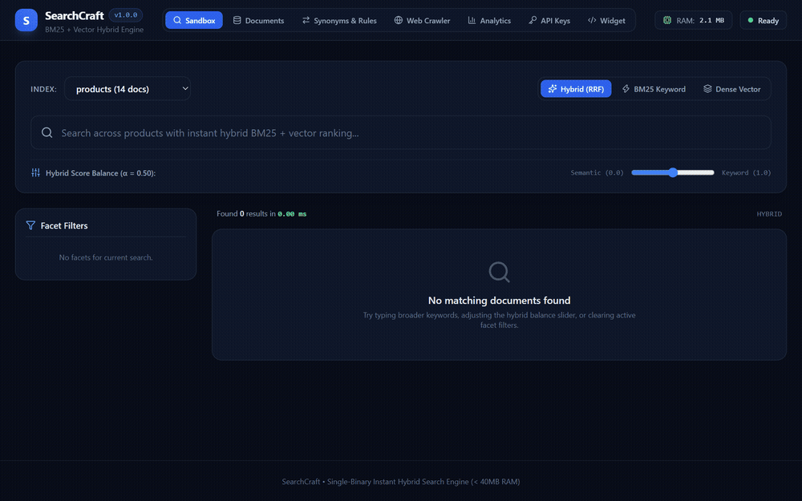
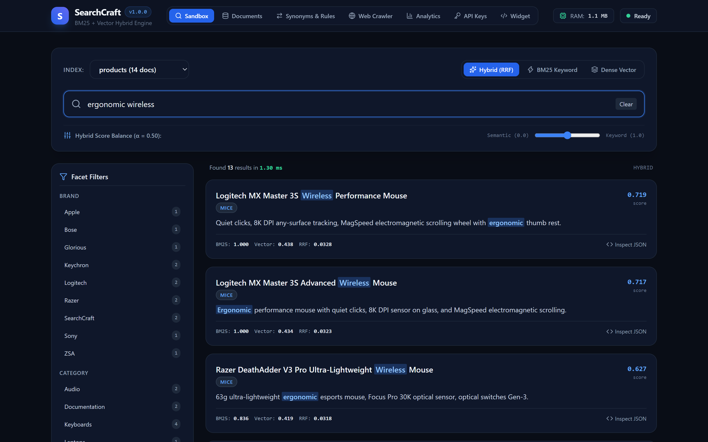
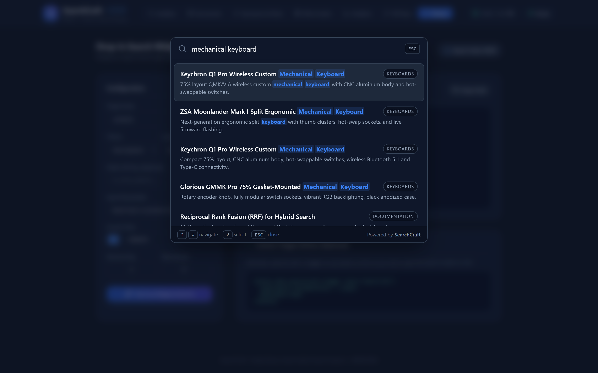
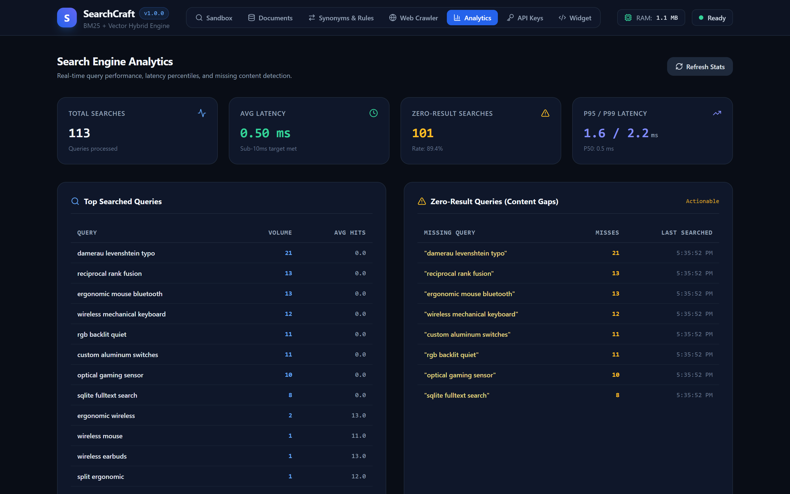
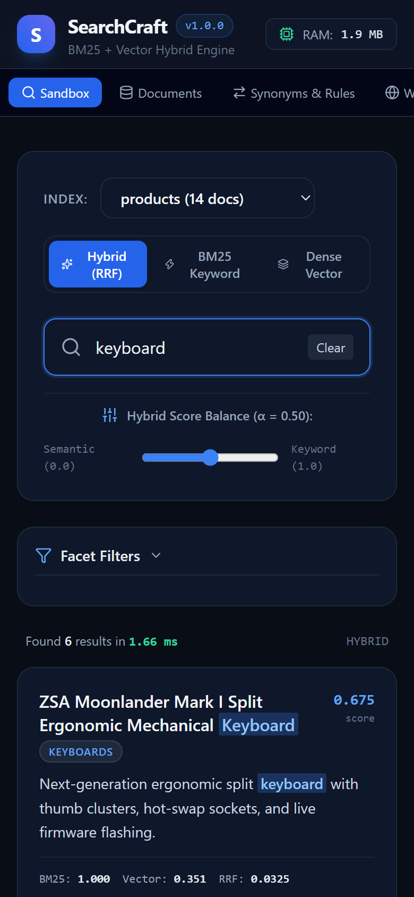

<p align="center">
  
</p>

<h1 align="center">SearchCraft</h1>

<p align="center">
  <strong>Lightweight single-binary hybrid search engine combining BM25 full-text search and dense vector embeddings with Reciprocal Rank Fusion (RRF), typo tolerance, and a 2KB drop-in command palette widget.</strong>
</p>

<p align="center">
  <a href="#overview">Overview</a> •
  <a href="#architecture">Architecture</a> •
  <a href="#visual-showcase">Visual Showcase</a> •
  <a href="#quick-start">Quick Start</a> •
  <a href="#drop-in-search-widget">Widget</a> •
  <a href="#cli-commands">CLI</a> •
  <a href="docs/API_SPEC.md">API Spec</a>
</p>

<p align="center">
  
</p>

---

## Overview

SearchCraft provides a self-hosted search engine designed for SaaS applications, documentation portals, and content websites. It offers instant search capabilities without requiring external JVM clusters or cloud search subscriptions.

Key characteristics:
- Memory footprint under 40MB RAM under normal workloads (under 2MB heap idle).
- Single Go binary with embedded SQLite FTS5 and vector capabilities.
- Hybrid search combining BM25 keyword matching and dense vector similarity through Reciprocal Rank Fusion (RRF).
- Damerau-Levenshtein typo-tolerance with adaptive token thresholds.
- Synonyms engine with one-way and bidirectional term expansion.
- Merchandising rules and curated promotion pinning.
- Integrated web crawler and XML sitemap ingester.
- Dynamic facet aggregation and range filtering.
- Standalone 2KB command palette search widget (Cmd+K) with Light/Dark/Auto themes and 5-language localization.
- Role-based API keys distinguishing public search tokens from administrative keys.
- Built-in React 19 administration studio for query debugging, analytics, and document inspection.

---

## Architecture

```
+-------------------------------------------------------------------------------+
|                               SEARCHCRAFT ENGINE                              |
+---------------------------------------+---------------------------------------+
                                        |
                +-----------------------+-----------------------+
                |                                               |
+---------------v---------------+               +---------------v---------------+
|     REST API & Ingestion      |               |     Hybrid Query Processor    |
| * POST /indexes/{id}/docs     |               | * BM25 Token Matching         |
| * Web Crawler & Sitemap       |               | * Typo Tolerance Engine       |
| * Synonyms & Merchandising    |               | * Dense Vector Similarity     |
| * Role-Based Access Control   |               | * Reciprocal Rank Fusion      |
+---------------+---------------+               +---------------+---------------+
                |                                               |
                +-----------------------+-----------------------+
                                        |
+---------------------------------------v---------------------------------------+
|                              STORAGE LAYER                                    |
| * SQLite Engine (WAL mode, normal sync, memory cache)                         |
| * Documents Table: JSON payload and metadata                                  |
| * FTS5 Table: Porter stemmer, trigram tokenizer, column weights               |
| * Vectors Table: Packed float32 BLOB vectors with cosine index                |
| * Synonyms & Promotions Tables: Term expansion & pinned results               |
| * Analytics Table: Query latencies, volume, zero-result queries               |
+---------------------------------------+---------------------------------------+
                                        |
                +-----------------------+-----------------------+
                |                                               |
+---------------v---------------+               +---------------v---------------+
|   2KB Standalone Search Widget|               |    React 19 Admin Studio      |
| * Cmd+K / Ctrl+K Modal        |               | * Live Search Sandbox         |
| * Auto Light/Dark Themes      |               | * Document & Index Explorer   |
| * Multi-Language (i18n)       |               | * Synonyms & Merchandising    |
| * Real-time Autocomplete      |               | * Integrated Web Crawler      |
| * Highlight Match Offsets     |               | * Widget Embed Code Generator |
+-------------------------------+---------------+-------------------------------+
```

---

## Visual Showcase

### Live Search Sandbox & Hybrid Score Breakdown
Test queries in real time with interactive hybrid balance slider (&alpha;), individual BM25 and vector score breakdowns, and dynamic facet filters:

<p align="center">
  
</p>

### Drop-In 2KB Search Widget (Cmd+K Modal)
Embed an instant keyboard-driven search modal into any webpage with a single script tag:

<p align="center">
  
</p>

### Query Analytics & Content Gap Detection
Track query volumes, latency percentiles (p50/p95/p99), and queries returning zero results:

<p align="center">
  
</p>

### Responsive Mobile Adaptation
Full responsive layout with collapsible facet filters and optimized touch navigation on mobile viewports:

<p align="center">
  
</p>

---

## Quick Start

### 1. Build and Run

Clone the repository and build the binary:

```bash
git clone https://github.com/alexandrmotologa/searchcraft.git
cd searchcraft
go build -o searchcraft ./cmd/searchcraft
./searchcraft serve --port 7700 --db ./searchcraft.db
```

The server starts on port `7700`. The admin studio is accessible at `http://localhost:7700`.

### 2. Create an Index

```bash
curl -X POST http://localhost:7700/api/v1/indexes \
  -H "Content-Type: application/json" \
  -d '{
    "name": "products",
    "field_boosts": {
      "title": 3.0,
      "description": 1.0,
      "brand": 1.5
    }
  }'
```

### 3. Ingest Documents or Crawl a Website

Ingest documents via REST API:

```bash
curl -X POST http://localhost:7700/api/v1/indexes/products/documents \
  -H "Content-Type: application/json" \
  -d '[
    {
      "id": "kb_01",
      "title": "Wireless Mechanical Keyboard",
      "description": "Compact 75% wireless mechanical keyboard with hot-swappable switches",
      "category": "Keyboards",
      "brand": "Keychron",
      "price": 89.99,
      "in_stock": true
    }
  ]'
```

Or crawl an entire website via sitemap.xml:

```bash
./searchcraft crawl --index docs https://docs.example.com/sitemap.xml
```

### 4. Search

```bash
curl -X POST http://localhost:7700/api/v1/indexes/products/search \
  -H "Content-Type: application/json" \
  -d '{
    "query": "mechanical wireless",
    "mode": "hybrid",
    "limit": 10,
    "facets": ["category", "brand"]
  }'
```

---

## Drop-In Search Widget

Add the standalone search widget to any webpage with a single script tag:

```html
<script
  src="http://localhost:7700/widget.js"
  data-url="http://localhost:7700"
  data-index="products"
  data-theme="auto"
  data-lang="en"
  data-placeholder="Search products..."
  data-accent="#3b82f6"
></script>
```

Press `Cmd+K` (macOS) or `Ctrl+K` (Windows/Linux) to open the palette. Use arrow keys and `Enter` to navigate results.

---

## CLI Commands

- `searchcraft serve [--port 7700] [--db searchcraft.db]`: Start HTTP engine, REST API, widget, and admin studio.
- `searchcraft import --index <name> --file <data.json>`: Batch ingest documents from JSON.
- `searchcraft crawl --index <name> [--max-pages 50] <url>`: Crawl and index website pages from URL or sitemap.
- `searchcraft export --index <name> [--out export.json]`: Export indexed documents.
- `searchcraft backup [--out backup.db]`: Create an atomic online snapshot using SQLite `VACUUM INTO`.
- `searchcraft key create --name "Widget" --role search`: Generate scoped API key.
- `searchcraft key list`: List active API keys.
- `searchcraft benchmark --index <name>`: Measure queries per second and latency percentiles.

---

## Documentation

- [REST API Specification](docs/API_SPEC.md)
- [Hybrid Search & RRF Architecture](docs/HYBRID_SEARCH.md)
- [Widget Integration Guide](docs/WIDGET_INTEGRATION.md)
- [Performance Benchmarks](docs/BENCHMARKS.md)

---

## License

MIT License. See [LICENSE](LICENSE) for details.
